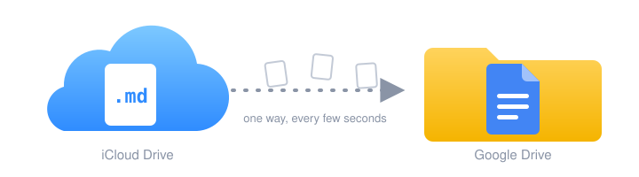

<p align="center">
  
</p>

# Drive Mirror

> My notes live in iCloud. Claude reads Google Drive. This is the duct tape.

Drive Mirror is a little macOS menu bar app. It watches Markdown folders in iCloud Drive and mirrors each `.md` file into Google Drive as a Google Doc. That makes the notes searchable and readable through Claude's Google Drive connector.

It's a personal tool for one Mac that stays awake. It works fine for me. Your mileage may vary!

**One way, on purpose.** iCloud is the source of truth. Drive holds a disposable copy under an `iCloud Mirror` folder, with one subfolder per mirrored folder. Nothing ever flows back.

- **Fast.** A saved note shows up in Drive about five seconds later.
- **Self-healing.** It also does a full pass on launch, on wake, and on a timer (hourly by default), so sleep, reboots, and dropped file events don't matter.
- **Honest about freshness.** Each folder in Drive gets a `_sync-status` Doc with the last sync time, what changed, and anything that's failing. Claude can read it to judge how stale the mirror is.
- **Hard to hurt you.** It only asks for the `drive.file` scope, so it can only see files it created. It never permanently deletes anything. It only trashes.

## Setup

About 20 minutes, most of it in Google Cloud's console.

### Google Cloud

1. Create a project and enable the **Google Drive API**. Easy to forget. The probe will tell you if you did. (Ask me how I know.)
2. Configure the OAuth consent screen as External, with yourself as the contact. Add only the `drive.file` scope.
3. Set the publishing status to **In production**. While it's "Testing," Google expires your sign-in every 7 days. `drive.file` isn't a restricted scope, so you don't need Google's verification. You'll click past an "unverified app" warning once.
4. Create an OAuth client of type **Desktop app** and download its JSON. Save it as `~/Library/Application Support/Drive Mirror/google-client.json`, or import it later from Settings.

### Your Mac

5. Sign Xcode in to your Apple ID (Settings → Accounts) and create an **Apple Development** certificate under Manage Certificates. Put your team ID in `Config/Local.xcconfig` (copy the `.example`). Without a stable signature, macOS asks for Keychain access again after every rebuild.
6. Run `sudo pmset -c sleep 0` so the Mac doesn't sleep. Display sleep is fine.
7. In Finder, right-click each folder you'll mirror and choose **Keep Downloaded**.

### First run

From the repo root (`alias mirrorctl='swift run --package-path Packages/MirrorCore mirrorctl'` saves typing):

8. `mirrorctl auth` signs in through your browser. The app shares this sign-in.
9. `mirrorctl probe` makes a throwaway folder in Drive, checks everything the app depends on, prints PASS/FAIL, and trashes the folder.
10. `mirrorctl sync <folder> --dry-run` prints what a sync would do, without touching Drive.

### The app

11. Build it, copy it to `/Applications`, and open it:
    ```sh
    scripts/test.sh
    cp -R "build/DerivedData/Build/Products/Debug/Drive Mirror.app" /Applications/
    open "/Applications/Drive Mirror.app"
    ```
12. In Settings, add your folders and turn on launch at login.
13. Check Drive for `iCloud Mirror/<folder>/` and its `_sync-status` Doc. Then ask Claude to find a phrase from one of your notes.

Where are my iCloud folders? iCloud Drive itself is `~/Library/Mobile Documents/com~apple~CloudDocs/`. Apps with their own iCloud folder (iA Writer, Obsidian, and friends) live next to it in `~/Library/Mobile Documents/`. The folder picker hides `~/Library`, so use the iCloud Drive sidebar entry or press ⌘⇧G and paste the path.

## Using it

The menu bar icon tells you how things are going: a checkmark cloud when all's well, a spinning cloud while syncing, an exclamation cloud when something needs you, and a pause symbol when paused.

The menu has the last sync time, a line per folder, **Sync Now**, **Pause**, **Open in Google Drive**, **Settings…**, and **Copy Diagnostics**. **Apply Pending Deletions** shows up only when the deletion guard is holding something (more below).

| Settings | What you can change |
|---|---|
| **Account** | Sign in or out. Import the client file. |
| **Folders** | Add or remove folders. Name each one (that's its Drive folder name). Include and exclude patterns, one per line, with `*`, `**`, and `?`. Turn **Convert to Google Docs** off to upload plain `.md` files instead. |
| **General** | Launch at login. The top-level Drive folder name. How often the full pass runs (15 minutes, 1 hour, 6 hours). The update strategy. |

Defaults: include `**/*.md`, exclude `.trash/` and `.obsidian/`. Hidden files are always skipped. Want `.txt` notes too? Add `**/*.txt` as an include pattern.

You'll get a macOS notification when something _newly_ goes wrong: files failing, deletions held, sign-in expired, or a folder gone missing. One per problem. Nothing for successful syncs, because who needs that.

## Things to know

- **Don't edit the Docs in Drive.** It's a mirror. Your next local edit overwrites them.
- **Code blocks lose their formatting.** Google's Markdown conversion turns fenced code into plain paragraphs. Still searchable, just not pretty. Everything else (headings, nested lists, emphasis, links, tables) converts well.
- **Excluding files trashes their Docs.** Changing patterns is a real change. The deletion guard catches big ones.
- **The deletion guard.** If a sync would trash more than 25% of a folder's Docs _and_ more than 10 Docs, it holds off and asks you. Usually that means iCloud hiccuped or the folder went missing. If the deletions are real, choose **Apply Pending Deletions**. A folder that can't be read never trashes anything.
- **Errors age out.** A file that's failed for 30 days without changing stops retrying and drops off the status Doc. Edit it or hit **Sync Now** to try again.
- **Trashed the Drive folder?** The next sync notices and rebuilds it from your local files.
- **"Replace" breaks links.** The default, **In place**, updates the same Doc so links keep working, and the probe confirmed it works. Replace makes a new Doc on every edit. Only use it if a future probe says In place stopped working.

## Troubleshooting

**Signed out every week.** The consent screen is still in "Testing." Switch it to "In production" and sign in again.

**Keychain prompts after every rebuild.** The build isn't signed with your development certificate. Check `DEVELOPMENT_TEAM` in `Config/Local.xcconfig`. If `security find-identity -v -p codesigning` shows zero valid identities even though the certificate exists, your keychain is missing Apple's intermediate certificate. Install the WWDR G3 certificate from [Apple's certificate authority page](https://www.apple.com/certificateauthority/) and it'll go valid.

**`mirrorctl` hangs with no output.** It's waiting on a Keychain prompt, probably hiding behind a window. Each rebuild of `mirrorctl` asks again. Click **Always Allow**.

**Files stuck "waiting for iCloud to download."** The app asks iCloud for them and retries next pass. Turn on Keep Downloaded for the folder and check iCloud in System Settings.

**State looks wrong.** Quit the app, then run `mirrorctl rebuild-state` (or delete `~/Library/Application Support/Drive Mirror/state.json` and relaunch). State rebuilds from metadata stored on the Docs themselves. No duplicates, no re-uploads.

**Something else.** Choose **Copy Diagnostics** from the menu. Logs live in `~/Library/Application Support/Drive Mirror/drive-mirror.log` and in Console.app under `dev.krw.DriveMirror`.

## Development

All the logic lives in the `MirrorCore` Swift package and is tested with `swift test`. The app target is a thin SwiftUI layer, generated by XcodeGen from `project.yml`. `mirrorctl` is a CLI over the same code. Zero third-party dependencies.

| Command | What it does |
|---|---|
| `mise install` | Installs pinned tools (XcodeGen, actionlint) |
| `/usr/bin/make check` | Lint, tests, and an app build. Unsigned if no team is set. What CI runs. |
| `/usr/bin/make format` | Formats the Swift sources |
| `mise exec -- xcodegen generate` | Generates `DriveMirror.xcodeproj` (gitignored) for Xcode |
| `LIVE_DRIVE=1 swift test --package-path Packages/MirrorCore` | Adds the test that hits your real Drive |
| `UPDATE_GOLDEN=1 swift test --package-path Packages/MirrorCore` | Regenerates the golden request fixtures. Review the diff! |

Everything lives in `~/Library/Application Support/Drive Mirror/` (`config.json`, `state.json`, the log, and `google-client.json`). The refresh token lives in the Keychain. The app and `mirrorctl` share both.

P.S. Claude Code wrote most of this, with me poking at it and saying "no, not like that." See `AGENTS.md` if you're an agent picking it up.
